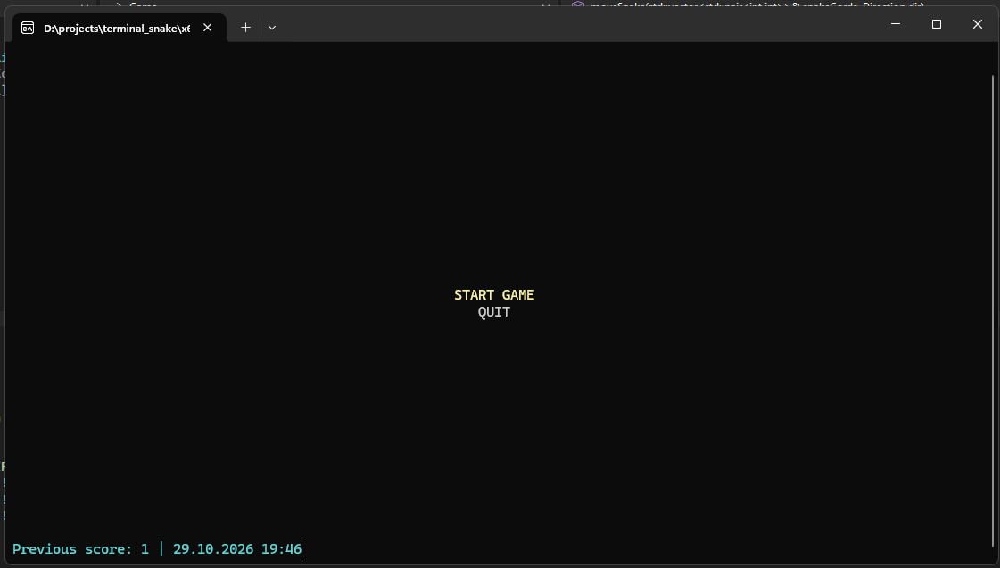
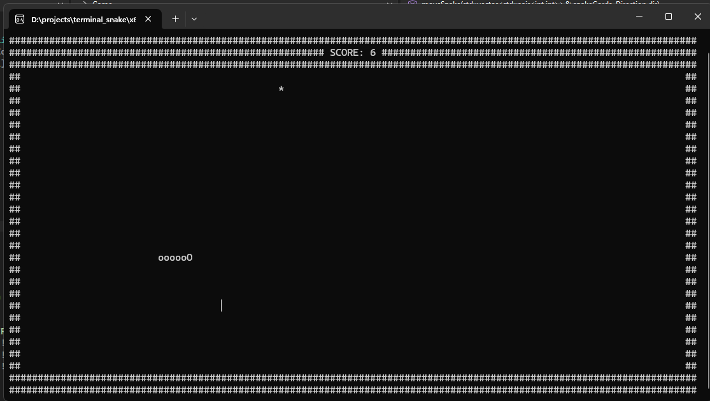

<div align="center">

# Terminal Snake

A small Snake game that runs in the Windows terminal.

</div>

## Screenshots

|                Menu                |               Gameplay                |
| :--------------------------------: | :-----------------------------------: |
|  |  |

## About

Terminal Snake is a console-based version of the classic Snake game. Move around the playfield, collect food, and try not to hit the walls or your own tail.

The game includes a simple menu and keeps the most recent score between runs.

## Controls

- **W / A / S / D** — move the snake
- **Arrow Up / Arrow Down** — navigate the menu
- **Enter** — select a menu option

## Build

The project uses C++20 and the Windows console API.

To build it:

1. Open `terminal_snake.slnx` in Visual Studio.
2. Make sure the **Desktop development with C++** workload and a Windows SDK are installed.
3. Select the `x64` platform and either `Debug` or `Release`.
4. Build and run the project.

The current implementation uses Windows-specific headers and console functions, so it is intended to run on Windows.

## Project structure

```text
terminal_snake/
├── data.cpp / data.h          # Read and write the previous result
├── direction.h                # Snake movement directions
├── game.cpp / game.h          # Game loop, movement, input and rendering
├── main.cpp                   # Application entry point and mode loop
├── menu.cpp / menu.h          # Main menu
└── mode.h                     # Menu, game and exit states
```

## Results

After a game ends, the score and date are appended to `results.txt`. The menu displays the most recent saved result on the next run.

## License

No license has been specified yet.
